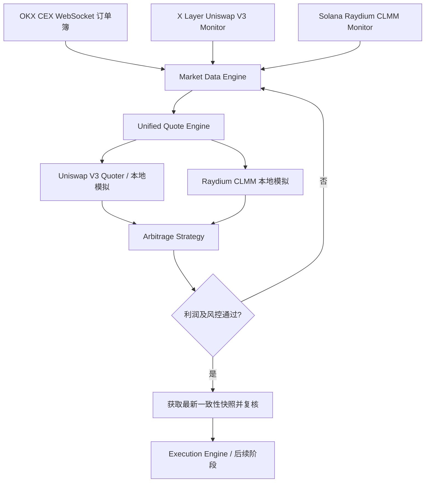

# OKX 股票代币套利系统：X Layer Uniswap V3 与 Solana Raydium CLMM 实时监听（TypeScript）

> 文档类型：技术设计与实现指南  
> 版本：V1.0  
> 更新时间：2026-10-14  
> 技术栈：TypeScript / Node.js / viem / @solana/web3.js / Raydium SDK V2
>
> **定位**：先完成只读行情监控与指定数量的 DEX 报价，再与 OKX CEX 订单簿比较。本文不提供可直接使用真实资金交易的全自动下单程序。

## 1. 目标与边界

面向 OKX CEX 与 X Layer、Solana 之间的股票代币价差监控，开发两个独立的市场数据适配器：

- **X Layer / Uniswap V3**：通过 EVM WebSocket 监听 `Swap` 事件，必要时同步 `Mint`、`Burn` 等事件和完整池状态；使用 QuoterV2 或受控本地模拟计算指定数量的兑换结果。
- **Solana / Raydium CLMM**：通过 Solana RPC WebSocket 订阅 Pool State 等账户变化，读取 Tick Array 与流动性状态；通过 Raydium SDK V2 模拟具体交易规模的报价。
- **统一报价层**：将两条链的报价、状态版本、费用、输入输出 Token 转换为一个标准数据结构。
- **套利策略层**：将 CEX 订单簿、DEX 报价、股票份额乘数、稳定币汇率、Gas / 网络费和库存再平衡成本放在一起计算净利润。

### 1.1 不应混淆三类价格

| 数据 | 说明 | 是否足以执行套利 |
|---|---|---|
| Spot Price（边际价格） | 由池当前状态计算出的参考单价 | 否 |
| Exact-In / Exact-Out Quote | 指定输入或目标输出量的模拟成交数额 | 用于预估，仍需复核 |
| Actual Fill（真实成交） | 链上最终交易的实际 Token 变化及费用 | 用于记账与复盘 |

即使监控使用链上 RPC，最终交易仍有状态变化、交易排序、滑点、失败等风险；**报价不是成交承诺**。

## 2. 整体架构



初期结构：

```text
stock-arbitrage/
├── src/
│   ├── config/
│   │   └── pools.ts
│   ├── chains/
│   │   ├── xlayer/
│   │   │   ├── client.ts
│   │   │   ├── uniswap-v3-monitor.ts
│   │   │   └── uniswap-v3-quote.ts
│   │   └── solana/
│   │       ├── connection.ts
│   │       ├── raydium-monitor.ts
│   │       └── raydium-quote.ts
│   ├── market/
│   │   └── okx-orderbook.ts
│   ├── strategy/
│   │   └── arbitrage.ts
│   ├── shared/
│   │   └── types.ts
│   └── index.ts
├── .env
├── package.json
└── tsconfig.json
```

初始化依赖：

```bash
pnpm add viem @solana/web3.js @raydium-io/raydium-sdk-v2 bn.js decimal.js dotenv
pnpm add -D typescript tsx @types/node
```

> Raydium SDK 的函数签名可能随版本调整，下面包含**可直接复用的 RPC 监听示例**与**SDK 调用示意**。请锁定 SDK 版本、以当前导出的 TypeScript 类型为准，不能未经测试就将示意代码用于真实资金交易。

## 3. V2：X Layer Uniswap V3 实时监听

### 3.1 配置 X Layer RPC

X Layer 主网 EVM Chain ID 为 `196`。HTTP RPC 可用于 `eth_call`、区块同步；WebSocket RPC 应支持 `eth_subscribe`。

`.env`：

```dotenv
XLAYER_RPC_HTTP=https://rpc.xlayer.tech
XLAYER_RPC_WS=wss://YOUR_XLAYER_WS_ENDPOINT
XLAYER_POOL=0x2a2b11730c2b6d99a58034a869dd810d7300a7b2
```

这里的 Pool 是之前讨论的 `wNVDAx/USDG` **候选池地址**。生产使用前必须验证池子所属工厂、`token0/token1`、手续费等级与对应资产的真实性。

`src/chains/xlayer/client.ts`：

```typescript
import { createPublicClient, defineChain, http, webSocket } from 'viem'
import 'dotenv/config'

export const xlayer = defineChain({
  id: 196,
  name: 'X Layer',
  nativeCurrency: {
    name: 'OKB',
    symbol: 'OKB',
    decimals: 18,
  },
  rpcUrls: {
    default: { http: ['https://rpc.xlayer.tech'] },
  },
})

export const xlayerHttp = createPublicClient({
  chain: xlayer,
  transport: http(process.env.XLAYER_RPC_HTTP ?? 'https://rpc.xlayer.tech'),
})

if (!process.env.XLAYER_RPC_WS) {
  throw new Error('缺少 XLAYER_RPC_WS')
}

export const xlayerWs = createPublicClient({
  chain: xlayer,
  transport: webSocket(process.env.XLAYER_RPC_WS),
})
```

### 3.2 监听 Uniswap V3 Swap 事件

Uniswap V3 `Swap` 事件包括 `amount0`、`amount1`、交易后的 `sqrtPriceX96`、`liquidity` 和 `tick`。

`src/chains/xlayer/uniswap-v3-monitor.ts`：

```typescript
import { parseAbi, type Address } from 'viem'
import { xlayerWs } from './client'

export const poolEventsAbi = parseAbi([
  'event Swap(address indexed sender, address indexed recipient, int256 amount0, int256 amount1, uint160 sqrtPriceX96, uint128 liquidity, int24 tick)',
])

export function watchUniswapV3Pool(poolAddress: Address) {
  return xlayerWs.watchContractEvent({
    address: poolAddress,
    abi: poolEventsAbi,
    eventName: 'Swap',
    onLogs(logs) {
      for (const log of logs) {
        if (log.removed) {
          console.warn('检测到区块重组，需回滚缓存并重新同步', log)
          continue
        }
        console.log({
          pool: poolAddress,
          blockNumber: log.blockNumber?.toString(),
          transactionHash: log.transactionHash,
          logIndex: log.logIndex,
          amount0: log.args.amount0?.toString(),
          amount1: log.args.amount1?.toString(),
          sqrtPriceX96: log.args.sqrtPriceX96?.toString(),
          liquidity: log.args.liquidity?.toString(),
          tick: log.args.tick,
        })
      }
    },
    onError(error) {
      console.error('Uniswap V3 事件订阅失败：', error)
    },
  })
}
```

启动监听：

```typescript
import { watchUniswapV3Pool } from './chains/xlayer/uniswap-v3-monitor'

const stop = watchUniswapV3Pool(
  '0x2a2b11730c2b6d99a58034a869dd810d7300a7b2',
)

// 关闭程序时调用 stop()
```

**重要**：Swap 事件只能帮助更新价格附近的状态，不能替代完整的 Tick 流动性信息。精确模拟大额兑换，仍需 Tick Bitmap / Tick 数据或协议 Quoter。监听需补充 `Mint/Burn`、断线重连、`getLogs` 补抓和重组处理。

### 3.3 从 sqrtPriceX96 计算边际价格

Uniswap V3 价格公式：

\[
P_{1/0} = \left(\frac{\mathrm{sqrtPriceX96}}{2^{96}}\right)^2 \times 10^{d_0-d_1}
\]

其中 `d0`、`d1` 分别为 `token0`、`token1` 的 decimals。**一定先读取 `token0()`、`token1()` 与 `decimals()`**，如果实际需要 `token0/token1` 报价，应对该公式的结果取倒数。

```typescript
import Decimal from 'decimal.js'

export function sqrtPriceX96ToPrice(
  sqrtPriceX96: bigint,
  decimals0: number,
  decimals1: number,
): Decimal {
  const sqrt = new Decimal(sqrtPriceX96.toString())
  const q96 = new Decimal(2).pow(96)
  return sqrt.div(q96).pow(2)
    .mul(new Decimal(10).pow(decimals0 - decimals1))
}
```

此结果只是**当前边际价格**，不能直接乘上大额交易数量当作可成交收入。

### 3.4 Uniswap V3 指定数量的 Quote

对兼容 Uniswap V3 QuoterV2 的协议，在 **已核实其 X Layer 部署地址** 后，可使用 `eth_call` 模拟 `quoteExactInputSingle()`；因为 QuoterV2 相关方法并非普通 `view`，在 viem 中可通过 `simulateContract` 获取结果。

```typescript
import { parseAbi, type Address } from 'viem'
import { xlayerHttp } from './client'

const quoterV2Abi = parseAbi([
  'function quoteExactInputSingle((address tokenIn, address tokenOut, uint256 amountIn, uint24 fee, uint160 sqrtPriceLimitX96) params) returns (uint256 amountOut, uint160 sqrtPriceX96After, uint32 initializedTicksCrossed, uint256 gasEstimate)',
])

export async function quoteUniswapV3(params: {
  quoter: Address
  tokenIn: Address
  tokenOut: Address
  amountIn: bigint
  fee: number
}) {
  const { result } = await xlayerHttp.simulateContract({
    address: params.quoter,
    abi: quoterV2Abi,
    functionName: 'quoteExactInputSingle',
    args: [{
      tokenIn: params.tokenIn,
      tokenOut: params.tokenOut,
      amountIn: params.amountIn,
      fee: params.fee,
      sqrtPriceLimitX96: 0n,
    }],
  })
  return {
    amountOut: result[0],
    sqrtPriceAfter: result[1],
    ticksCrossed: result[2],
    gasEstimate: result[3],
  }
}
```

这里的 `fee` 是 Uniswap V3 的费率整数表示（如 `500` 表示 0.05%）。Quoter 使用合约内部状态对指定数量进行模拟，**报价可能在下单前发生变化**。若所在 DEX 并未部署兼容的 QuoterV2，需要改用该协议 SDK / Quoter 或自己实现 tick-step 模拟。

### 3.5 X Layer 建议的监听-报价闭环

```text
WebSocket Swap/Mint/Burn 日志
        ↓
更新本地池状态 + 记录 blockNumber/logIndex
        ↓
计算边际价格（只用于候选筛选）
        ↓
符合预筛阈值
        ↓
QuoterV2 / 本地 Swap 数学：指定交易量
        ↓
净利润计算与交易前复核
```

## 4. V3：Solana Raydium CLMM 实时监听

### 4.1 Solana RPC 配置

`.env`：

```dotenv
SOLANA_RPC_HTTP=https://YOUR_SOLANA_RPC
SOLANA_RPC_WS=wss://YOUR_SOLANA_RPC
SOLANA_POOL_ID=49iMatQtoyabsYAQc8GafVq6aeBFVDxSRH44oiatyyw6
NVDAX_MINT=YOUR_VERIFIED_NVDAX_MINT
```

上面 Pool ID 为之前研究的 `NVDAx/USDC` **候选池**，需验证其 owner 是否为正确的 Raydium CLMM Program、Token Mint 是否与 OKX 支持的资产对应，并检查池手续费与流动性。

`src/chains/solana/connection.ts`：

```typescript
import { Connection } from '@solana/web3.js'
import 'dotenv/config'

if (!process.env.SOLANA_RPC_HTTP || !process.env.SOLANA_RPC_WS) {
  throw new Error('必须设置 SOLANA_RPC_HTTP / SOLANA_RPC_WS')
}

export const solanaConnection = new Connection(
  process.env.SOLANA_RPC_HTTP,
  {
    wsEndpoint: process.env.SOLANA_RPC_WS,
    commitment: 'confirmed',
  },
)
```

### 4.2 Raydium SDK V2 初始化

```typescript
import { PublicKey } from '@solana/web3.js'
import { Raydium } from '@raydium-io/raydium-sdk-v2'
import { solanaConnection } from './connection'

export async function createRaydium() {
  return Raydium.load({
    connection: solanaConnection,
    owner: PublicKey.default,
    cluster: 'mainnet',
    disableFeatureCheck: true,
    disableLoadToken: true,
  })
}
```

这适用于**只读**场景，不需要私钥。Raydium SDK V2 API 随版本会变动，建议在锁定版本后检查 `Raydium.load`、`clmm` 模块方法的实际签名。

### 4.3 实时订阅 Pool Account

Solana 监听使用的是账户订阅，不是 EVM 的智能合约日志。下面是可用于验证订阅链路的最小实现：

```typescript
import { PublicKey } from '@solana/web3.js'
import { solanaConnection } from './connection'

export async function watchPoolAccount(poolId: string) {
  const address = new PublicKey(poolId)
  const subscriptionId = solanaConnection.onAccountChange(
    address,
    (accountInfo, context) => {
      console.log({
        poolId,
        slot: context.slot,
        owner: accountInfo.owner.toBase58(),
        dataLength: accountInfo.data.length,
      })
      // 后续：用 Raydium 对应版本的 PoolStateLayout 解码 accountInfo.data
    },
    'confirmed',
  )

  return async () => {
    await solanaConnection.removeAccountChangeListener(subscriptionId)
  }
}
```

**初期版本**可以在账户变化时触发一次 Raydium SDK 的 RPC 池状态刷新；但不要把 WebSocket 通知 `slot` 与后续 HTTP 请求获取的池数据 `slot` 混为同一状态版本。

Raydium CLMM 还需要关注：

- Pool State：`sqrtPriceX64`、`tickCurrent`、`liquidity`；
- Tick Array：当前价格附近及预期会跨越的 tick；
- 配置账户：费用等协议参数；
- 影响报价的其他账户：如特定 Token Program / Token-2022 扩展状态。

在建立完整本地缓存后，再将变化通知直接解码为可使用的池状态，减少频繁 RPC 拉取。

### 4.4 Raydium CLMM 价格计算

Raydium CLMM 的当前价格平方根编码为 `sqrtPriceX64`（Q64.64）：

\[
P_{B/A}=\left(\frac{\mathrm{sqrtPriceX64}}{2^{64}}\right)^2\times 10^{d_A-d_B}
\]

如果 Token A 是 NVDAx、Token B 是 USDC，那么这是 `USDC/NVDAx` 的边际价格；如果顺序相反应取倒数。

**不能**仅根据价格与总储备计算指定数量成交价，因为 CLMM 可能跨多个 tick，跨越时有效流动性也可能改变。

### 4.5 使用 Raydium SDK 模拟固定池报价

前面讨论过通过 Raydium SDK V2 的 `getSwapPoolInfo()`、`swapInternal()` 和 Tick Bitmap 数据计算指定池 `ExactIn` 报价，其思想如下：

```typescript
// 结构性伪代码：Raydium SDK V2 的具体方法、字段名
// 需以锁定版本的类型定义与源码为准。
async function quoteRaydiumClmmExactIn(params: {
  poolId: string
  tokenInMint: string
  rawAmountIn: bigint
}) {
  // 1. 从可信池注册表核实 programId、mintA、mintB、decimals
  // 2. 从 RPC 获取 Pool State、配置、Tick Arrays、Tick Bitmap 扩展
  // 3. 判断 zeroForOne，选择正确兑换方向
  // 4. 由 SDK 的 CLMM SwapMath / swapInternal 逐 Tick 模拟
  // 5. 输出 amountOut、手续费与输入数据版本 slot
  // 6. 对 Token-2022 扩展和转账费做单独校验
  throw new Error('按 Raydium SDK 锁定版本实现')
}
```

为什么这一段保留为伪代码：Raydium SDK V2 的内部 `swapInternal`、`getSwapPoolInfo` 以及相关 Tick Bitmap 结构在不同版本间可能存在导出、入参和返回值差异。要保证能编译并可用于资金决策，需要根据项目已锁定的 `pnpm-lock.yaml` 检查真实类型，而不应直接依赖未经运行验证的示例。

实现过程中：

1. 查询池 Token Mint 顺序与精度；
2. 获取池状态、费率和当前方向所需的 Tick Arrays；
3. 按 **输入 Token 最小单位整数**传入待交易数量；
4. 按协议版本执行逐 Tick 模拟与整数取整；
5. 返回原始整数 `amountOut`、费用和 Slot；
6. 用公开聚合器报价作为交叉验证，而不是直接认为模拟结果代表最终成交。

### 4.6 Solana 监听-报价闭环

```text
Pool Account / Tick Array 账户变化
        ↓
本地缓存更新（携带 slot）
        ↓
计算边际价格（候选筛选）
        ↓
符合候选阈值
        ↓
拿到一致性池快照 + Tick Arrays
        ↓
Raydium CLMM Swap 数学模拟
        ↓
Exact-In / Exact-Out 报价
        ↓
净利润计算 + 交易前复核
```

## 5. 统一两条链的报价接口

策略层不应该关心 X Layer 的 `sqrtPriceX96` 与 Solana 的 `sqrtPriceX64`。建议统一定义：

`src/shared/types.ts`：

```typescript
export type Chain = 'xlayer' | 'solana'
export type Dex = 'uniswap-v3' | 'raydium-clmm'

export interface DexQuote {
  chain: Chain
  dex: Dex
  poolId: string
  tokenIn: string
  tokenOut: string
  // 最小单位整数，始终以十进制字符串序列化
  amountIn: string
  amountOut: string
  // 仅表示池手续费是否已体现在最终 amountOut 中
  poolFeeIncluded: boolean
  blockNumber?: bigint
  slot?: number
  quotedAt: number
  // USD 等值网络费需单独估算，不应盲目加到 amountOut
}

export interface QuoteProvider {
  quoteExactIn(input: {
    poolId: string
    tokenIn: string
    amountIn: bigint
  }): Promise<DexQuote>
}
```

Provider 划分：

```text
QuoteProvider
├── XLayerUniswapV3Provider
├── SolanaRaydiumCLMMProvider
├── OKXAggregatorProvider       （可选校验）
└── JupiterProvider             （可选校验）
```

真实项目建议额外添加：

- `tokenDecimals`、报价币种及标的资产对应关系；
- 状态版本（blockHash、Slot、commitment）和订阅延迟；
- `estimatedNetworkFee`、包装/解包和汇兑费用；
- `quoteId`、错误码、有效期、是否已做传输费处理；
- `route`（单池/多跳）、风险等级和执行约束。

## 6. 与 OKX CEX 订单簿进行套利比较

**股票代币套利必须先统一成相同的股票等值份额**。例如 OKX 站内的 `XNVDA` 与链上 `NVDAx` 可能存在动态乘数，而 X Layer 还可能存在 `wNVDAx ↔ NVDAx` 的额外兑换比例。

示例（仅说明方向）：

```text
OKX XNVDA 订单簿                 链上 NVDAx / wNVDAx 池
        │                                   │
        ▼                                   ▼
计算同等股份的 CEX 买/卖成本    模拟固定数量的链上买/卖报价
        │                                   │
        └───────────────┬───────────────────┘
                        ▼
             统一 USD 等值 & 扣除费用
                        ▼
               判断净利润和风险
```

两个方向：

\[
P_A=R_{\rm DEX,sell}-C_{\rm CEX,buy}-F_A
\]

\[
P_B=R_{\rm CEX,sell}-C_{\rm DEX,buy}-F_B
\]

其中：

- `R`：指定股票等值数量可预计收到的稳定币；
- `C`：买入对应敞口实际需要支付的稳定币；
- `F`：**尚未包含**在报价中的手续费、Gas / 优先费、包装/解包、稳定币汇兑、库存再平衡和风险缓冲；
- 如果 SDK 报价中的 `amountOut` 已经反映池手续费和价格影响，**不要重复扣除**。

> 举例：OKX 是 USDT、Solana 是 USDC、X Layer 是 USDG，不能直接按数值相减。先按实际可执行的稳定币兑换汇率换算。

## 7. 实时状态同步与生产环境注意事项

### 7.1 X Layer

- 程序启动时读取池元数据、`slot0()`、`liquidity()`、必要 tick；
- 订阅日志时保存 `blockNumber / logIndex / transactionHash`，区块重组时回滚；
- WebSocket 重连后用 `getLogs` 从上次确认位置补抓；
- 定期和 `eth_call` 最新状态对账；
- `Swap` 更新边际价格，流动性变化要额外维护 `Mint/Burn`；
- 不同区块的状态不能不加区分地合并后用于严格模拟。

### 7.2 Solana

- 读取并验证 Pool Account Owner、Mint、Program ID；
- WebSocket 订阅 Pool State 与报价必需的其他账户；
- 使用 Slot 与 Commitment 管理状态版本；
- 多账户的异步通知可能对应不同 Slot，严格报价要重新拉取一致性快照；
- 断线后重新获取账户数据并重建订阅；
- Tick Array 更新、Token-2022 转账费等会影响实际预估收入。

### 7.3 执行层共通要求

- 先做行情监测和模拟，验证费后利润；
- 提交前重新获取可执行报价，检查行情时效；
- CEX 与 DEX 无法原子成交，需要单边失败补偿；
- 控制滑点、最大未对冲敞口、单日亏损和最小利润；
- 链上广播成功不等于交易成功，必须查询回执/签名状态；
- OKX 统一股票资产、链上原生 Token 与 Wrapper 比例要动态核对。

## 8. 推荐实施顺序

| 阶段 | 目标 | 验收标准 |
|---|---|---|
| V2.1 | X Layer RPC + Uniswap V3 Swap 监听 | 正常收到日志；核实池与 Token；可算边际价格 |
| V2.2 | X Layer QuoterV2 指定数量报价 | 不同交易量的 AmountOut 与其他可靠报价交叉验证 |
| V3.1 | Solana RPC + Raydium Pool Account 监听 | 能连续记录 Slot、池账户变化、价格与流动性 |
| V3.2 | Raydium SDK Tick / CLMM 报价 | 指定金额模拟，覆盖可能跨 Tick 的兑换 |
| V4 | 统一 QuoteProvider + OKX 盘口 | 两个方向计算净利润，费用不重复扣减 |
| V5 | 风控、数据库与纸面交易 | 不发送真实交易；记录机会、时效、失败原因 |
| V6 | 小额执行与补偿 | 单腿失败、RPC 超时、状态恢复测试通过 |

**建议先实现 V2.1 + V3.1 的只读监听 MVP**，验证数据是否连续可靠；随后各自实现指定数量报价，再接 OKX 套利计算。不要一开始就同时做多链多池自动下单。

## 9. 官方资料

- [viem：watchContractEvent](https://viem.sh/docs/contract/watchContractEvent)
- [viem：simulateContract](https://viem.sh/docs/contract/simulateContract)
- [Uniswap V3 Core 官方仓库](https://github.com/Uniswap/v3-core)
- [Uniswap V3 Periphery 官方仓库](https://github.com/Uniswap/v3-periphery)
- [Solana RPC accountSubscribe](https://solana.com/docs/rpc/websocket/accountsubscribe)
- [Solana RPC getMultipleAccounts](https://solana.com/docs/rpc/http/getmultipleaccounts)
- [Raydium SDK V2](https://github.com/raydium-io/raydium-sdk-V2)
- [Raydium CLMM 核心实现](https://github.com/raydium-io/raydium-clmm)
- [OKX CEX API v5](https://www.okx.com/docs-v5/en/)

---

**最终设计原则**：WebSocket 负责发现变化，链上池状态负责本地定价，指定交易量的 Quote 用来判断可执行性，交易前再复核。X Layer 侧使用 EVM 事件和 Quoter，Solana 侧使用账户订阅与 Raydium CLMM 数学；对套利策略暴露统一接口即可。
